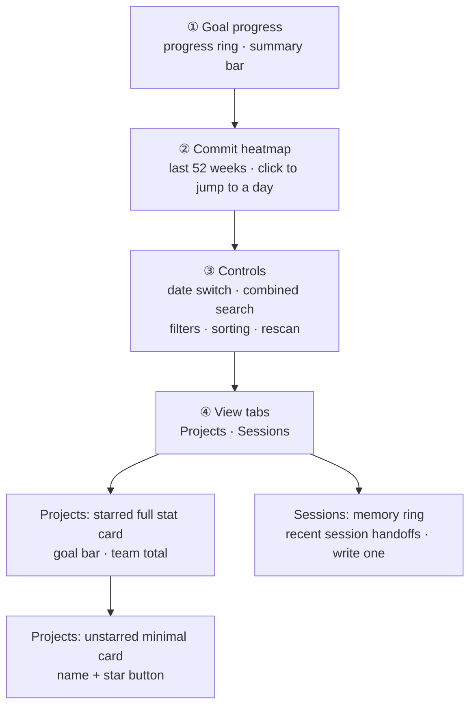

# Dashboard

The dashboard shows daily commit statistics, goal progress, and a year-long commit heatmap across all projects.

> **Standalone page (`/dashboard`)**: the dashboard is a separate top-level route, reached from the "Dashboard" item in the main navigation; the home page (`/`) is a full-page console (ask + search). Dashboard panels (goal ring, heatmap, project grid, starred stats) keep full functionality — not hidden by default — they simply live under their own route.
>
> **The one place for "my output"** (ADR-0038, decision 5): project counts, repo counts and added lines have exactly one authority — the dashboard. Home no longer computes any of them, and the memory ring (recent session handoffs) moved here: it belongs to "my state", not to "my answer".

## Page structure (top to bottom)

How to read it: the fixed header is a **vertical reading order**, three bands; below it comes the **scroll area**, which has two tabs (ADR-0039, decision 4) — "Projects" and "Sessions" are two unrelated kinds of content and only one is ever needed at a time, so they are tabs rather than things stacked side by side. The heatmap (②) is the global time view, the control bar (③) is its operating panel (switching the date changes both the heatmap and the project cards at once), and the project list splits cards by starred state — unstarred shows only the name, and you have to star a repository before it shows statistics. All three bands follow the **git author setting** (see [Settings](settings.md#author-configuration)).

> **Why "Sessions" is a tab rather than the block at the top of the page**: the memory ring is about "the last session", the project list is about "today's output". Stacking those two as equals is the very shape ADR-0038 set out to destroy, reappearing one level down. The tab strip itself is on the first screen, and the "Sessions" tab carries a **badge with the number of handoff records**, so "3 records I haven't read" is visible at a glance — the badge is the load-bearing part here, not decoration.
>
> **The "All / Starred" filter stays as it is**: it switches the **scope of the fetch** (the summary bar follows), not "which block you are looking at", so it is a chip rather than a tab.

### Sessions tab: the memory ring

The "Sessions" tab holds **recent session handoffs**. Click one to open the owning project; auto-captured ones carry an "Auto" badge. With no handoffs yet, a placeholder hint is shown.

The **"Write a handoff record"** button next to it is the **only zero-configuration way into the session loop** — automatic capture at session end needs an MCP client, a model and a client that remembers to call the tool, none of which a first-time user has; writing one by hand needs no configuration at all. It moved here for the same reason the ring did: the memory ring belongs to "my state", while the home console belongs to "my answer".

### Goal progress

- **Progress ring**: today's (or the selected date's) personal added lines vs the daily goal; no goal is shown on non-workdays
- **Subtitle**: how far you are from the goal, personal additions / file count / repos involved
- **Summary bar**: team additions / deletions, personal additions / files, total todo count. The strip's **scope follows the list filter**: under "Starred" it aggregates only starred projects' repositories (todos included), so the header numbers always match the project rows below; "All" is the whole-library scope

### Commit heatmap

Daily commit density over the last 52 weeks (GitHub style). Click any cell to jump to that date and see that day's per-project data. Stats follow the current git author (Settings → Author configuration).

### Controls

- **Date switcher**: yesterday / today / any date
- **Unified search box**: search repos, notes, and todos as you type (300ms debounce; results can be starred or opened directly)
- **Filter**: all / starred only
- **Sort**: name / personal additions / file count / repo count
- **Rescan**: starts an async scan after a two-click confirmation; progress is shown live and data refreshes automatically when the scan completes

### Projects tab

- **Starred repos**: full stat cards (today's additions, goal progress bar, repos / files / additions / deletions, net growth, team totals, todo and note badges)
- **Other repos**: minimal cards (name + star button); star one to expand it when needed

## Feature details

### Starring repos

Click the star to star a repo: the card expands into full stats and a **backfill history** button appears (backfills the last 365 days of data on demand). Unstarring collapses it back to a minimal card immediately.

### Goal progress

**Settings → Code standard** sets the daily goal in lines (default 500, range 100-10000).

- The progress ring and card goal bars show completion; hitting the goal shows 🎉
- On workdays below the goal, cards show a "below target" warning; weekends never warn

### Project grouping

Projects are grouped automatically by parent directory (with Monorepo detection). To split/merge manually, see [Project detail](project-detail.md).
