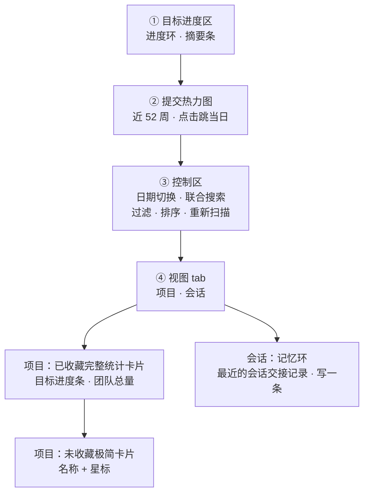

# 仪表盘

仪表盘展示所有项目的每日提交统计、目标进度与全年提交热力图。

> **独立页面（`/dashboard`）**：仪表盘是独立顶级页，主导航「仪表盘」直达；首页 (`/`) 是一整页对话台（问 + 搜）。仪表盘面板（目标环、热力图、项目网格、收藏统计）保留完整功能，不默认隐藏——它们在自己的路由下展示。
>
> **唯一一处「我的产出」**（[ADR-0038](../adr/0038-desktop-information-architecture.md) 决策 5）：项目数、仓库数、新增行数只有仪表盘有权威答案。首页不再自己算这些数字，记忆环（最近的会话交接记录）也搬到了这里——它属于「我的状态」，不属于「我要答案」。

## 页面结构（自上而下）

读图：固定头部是**一条竖直的阅读顺序**，往下三层自上而下；再往下是**滚动区**，它有两个 tab（[ADR-0039](../adr/0039-in-page-tabs-over-stacked-sections.md) 决策 4）——「项目」与「会话」是两种不相干的内容，一次只看一个，所以做成 tab 而不是并排堆着。热力图（②）是全局时间视图，控制区（③）是它的操作面板（日期切换会同时改变热力图与项目卡片的口径），项目列表按收藏状态分两种卡片密度——未收藏只给名称，想看统计得先点星标。三层都跟着 **git 作者配置**变（见[设置](settings.md#作者配置)）。

> **为什么「会话」是一个 tab 而不是页面最上面的一块**：记忆环讲的是「上次的会话」，项目列表讲的是「今天的产出」。两者平级堆叠，就是 ADR-0038 消灭掉的「同一种东西被拆成平级入口」的形状换了个位置复现。tab 栏本身就在首屏，「会话」tab 上带**交接记录条数徽标**，所以「有 3 条没看」一眼可见——徽标是这里的关键，不是装饰。
>
> **「全部 / 关注」过滤器不动**：它切的是**取数范围**（摘要条也跟着变），不是「看哪一块」，所以它是 chip 不是 tab。

### 会话 tab：记忆环

「会话」tab 里是**最近的会话交接记录**。点击直达所属项目，自动捕捉的带「自动」徽标；没有交接记录时显示占位提示。

旁边的「**写一条交接记录**」是**零配置进入会话循环的唯一入口**——会话结束时自动捕捉需要 MCP 客户端、模型和记得调用工具的客户端，头一次用的人一个都没有；手写一条不需要任何配置。它也搬到了这里：记忆环属于「我的状态」，而首页对话台属于「我要答案」。

### 目标进度区

- **进度环**：今日（或所选日期）个人新增行数 vs 每日目标；非工作日不显示目标
- **副标题**：距达标差值、个人新增 / 文件数 / 涉及仓库数
- **摘要条**：团队新增 / 删除、个人新增 / 文件、待办总数。口径**跟随列表筛选**：切到「关注」时，摘要条只聚合收藏项目的仓库（待办同理），与下方项目行的数字严格对应；「全部」即全库口径

### 提交热力图

近 52 周每日提交密度（GitHub 风格），点击任意格子跳转到该日期查看当天项目数据。统计范围跟随当前 git 作者（设置 → 作者配置）。

### 控制区

- **日期切换**：昨天 / 今天 / 任意日期
- **联合搜索框**：实时搜索仓库、笔记与待办（防抖 300ms，结果可直接星标或跳转）
- **过滤器**：全部 / 仅收藏
- **排序**：名称 / 个人新增 / 文件数 / 仓库数
- **重新扫描**：两击确认后触发异步扫描，进度实时展示，完成后自动刷新数据

### 项目 tab

- **已收藏仓库**：完整统计卡片（今日新增、目标进度条、仓库/文件/新增/删除、净增、团队总量、待办与笔记角标）
- **其他仓库**：极简卡片（名称 + 星标按钮），需要时再收藏展开

## 功能详解

### 仓库收藏

点击星标收藏仓库：卡片展开为完整统计，出现 **刷新历史** 按钮（按需回填近 365 天数据）。取消收藏立即折叠为极简卡片。

注意这与[快速开始](../getting-started.md)的上手路径是同一件事的两面：收藏**只为仪表盘统计**，不影响知识库可用性。

### 目标进度

**设置 → 代码标准** 配置每日目标行数（默认 500，范围 100-10000）。

- 进度环与卡片目标条显示完成度，达标显示 🎉
- 工作日未达标时卡片显示「未达标」告警；周末不告警

### 项目分组

自动按父目录分组（Monorepo 识别），手动拆分/合并见[项目详情](project-detail.md)。
