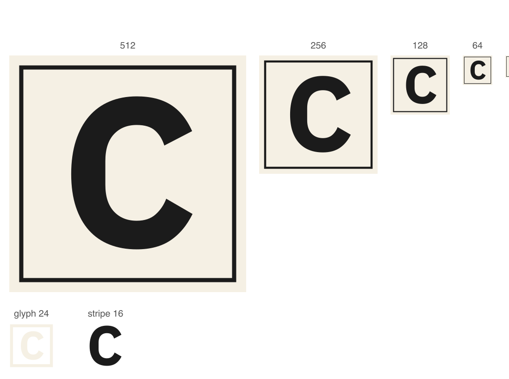
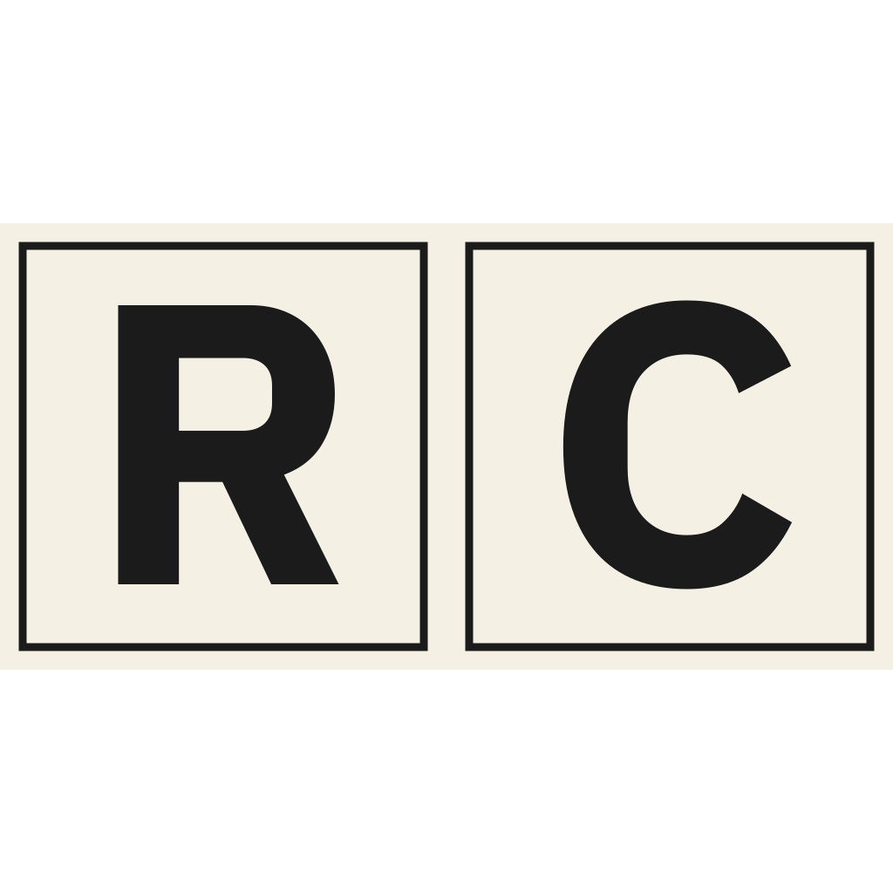

# 图标重构 v5 — 字母 R→C（换品牌，构造不动）

## 问题

品牌按 ADR-0049 换名：**Repotory → Cinder**（母品牌）、**Cinder Desktop**（桌面工作台）、**Warden**（Agent）。
母图里那个「R」从此不是品牌字母——它指向的是一个已经废止的词。

**换的是字母，不是构造。** 暖纸底 `#F5F0E4`、9 单位 hairline 墨框（512 网格、inset 26）、直角边、无渐变无投影、
「印出来的卡」这套识别构造**全部保留**：它们与字母无关，而字母是三者里唯一被品牌词绑住的那一个。

## 字母从哪里来

不是手描、不是找一个看着像 C 的路径——是**从字体轮廓重建**：

- 字源：IBM Plex Sans Bold（© IBM Corp., SIL OFL 1.1），v6.4.1（`@ibm/plex` 官方包）
- 母图的字母坐标系：cap 高 340 单位、基线在 y=426（y 向下）、组变换 `translate(21.06 13.06) scale(0.941176)`
- 映射：`x' = x·(340/698) + off`，`y' = 426 − y·(340/698)`

**管线自证**：用同一套管线重建旧的「R」，与已发布的 `build/icon.svg` 逐点比对——
所有 y 值与曲线控制点**完全一致**，x 只有常量 0.07 单位差（<0.07 画布像素）。管线是对的。

## 光学校正：C 为什么右移 9

母图的旧注释写「R 重心在字干一侧，所以右移 6」。这句话是**观感描述**，不是规则——换字母就没法照抄。

改成一条**可复算**的规则：**字形外接框中心与墨量重心之差的一半**（墨量重心用轮廓面积加权重心算）。
用这条规则回算旧的 R：12.9 母图单位 → 右移 6.07 画布像素，与母图记录一致。

对 C：外接框中心与重心差 19.07 母图单位 → 右移 8.97 ≈ 9 画布像素。
C 的开口朝右，右侧墨量天然偏少，所以重心在框心左侧——与 R 的方向一致，但幅度更大。

## 尺寸阶梯



- 品牌域（方卡）：512 / 256 / 128 / 64 / 48 / 32 / 16
- 字形域：VS Code 活动栏 24px（单色 + 透明底，ink 占 46%）、JetBrains 工具窗 16px（纯字母）



## 落地的连带影响

1. **C 没有字碗（counter）**：R 的轮廓是「外轮廓 + 内白」两段闭合路径，C 的开口朝外，**只有一段**。
   `BrandMark.test.tsx` 的「两段子路径」断言改成「一段」——顺带把「画的是哪个字母」也钉住了。
2. **活动栏 ink 覆盖率 35% → 46%**：C 的圆环比 R 的字面覆盖更多，仍远低于 75% 的「实心板」红线。
3. **JetBrains 工具窗的取景框自动跟随**：`generate-icons.mjs` 的 `alphaBBox` 是从渲染结果反推字母实际位置，
   所以换字母不用改代码；改字形位置它自己跟上。

## 校验

```bash
node scripts/generate-icons.mjs            # 重新生成全部衍生图标
node scripts/generate-icons.mjs --check    # 三个域全部同步
```
